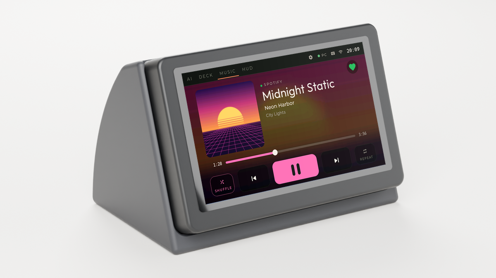
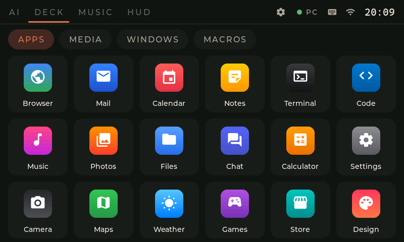
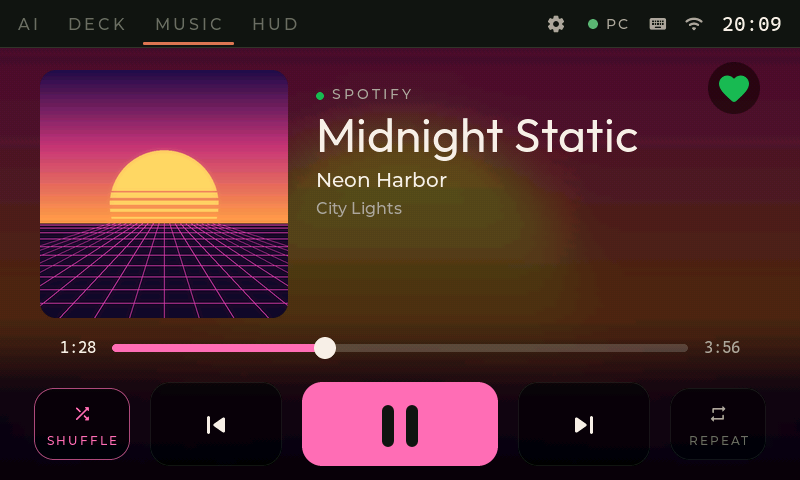
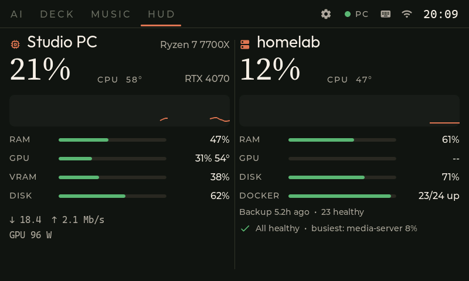
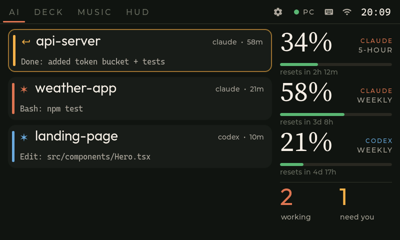
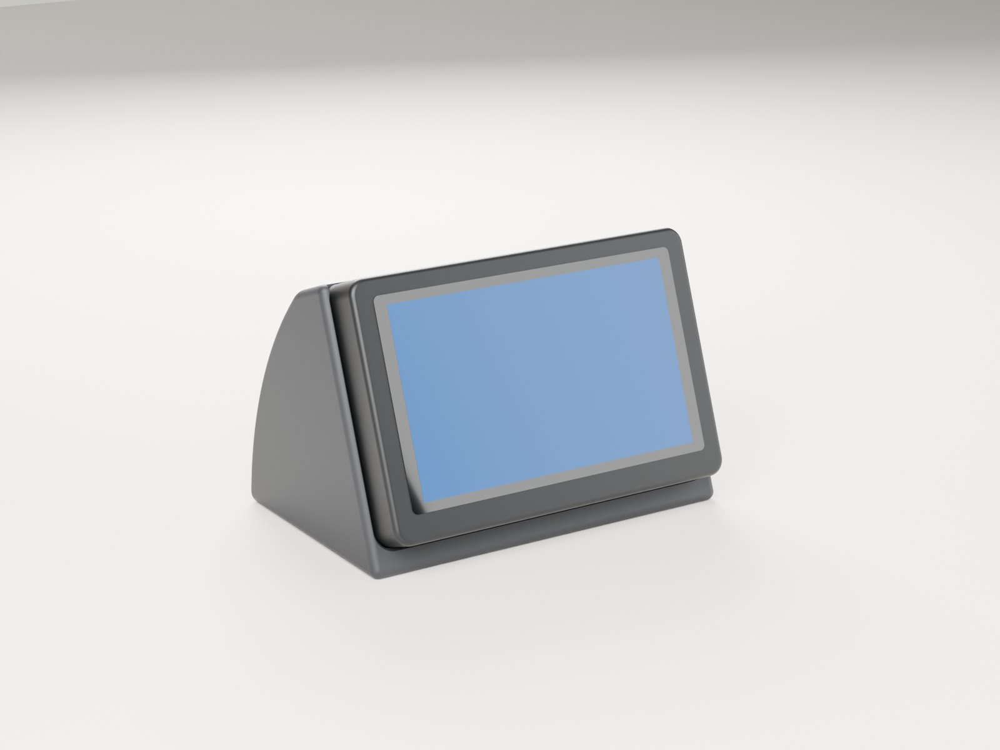
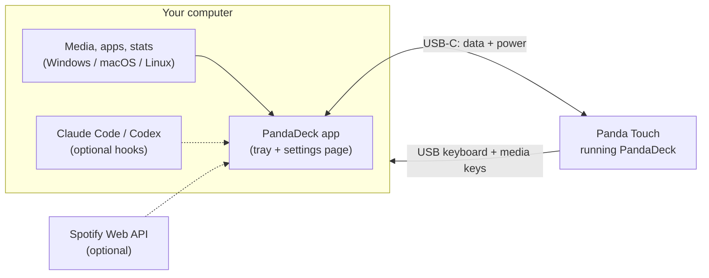

  

<h1 align="center">PandaDeck</h1>

  <b>Turn the BIGTREETECH Panda Touch into a desk companion for your computer.</b> 
  A touch stream deck and app launcher, a now-playing music remote, a live PC dashboard —
  and, if you code with AI, a mission control for Claude Code and Codex.

  <a href="docs/guide/01-flash-the-panel.md">Install guide</a> ·
  <a href="../../releases/latest">Download</a> ·
  <a href="docs/guide/09-troubleshooting.md">Troubleshooting</a> ·
  <a href="docs/guide/10-build-from-source.md">Build from source</a> ·
  <a href="https://paypal.me/theboss3dfactory">♥ Support</a>

---

The Panda Touch is a lovely 5" 800×480 touchscreen built around an ESP32-S3, originally
sold as a remote screen for Bambu Lab printers. PandaDeck replaces its firmware and gives
it a new job on your desk. **Plug it into your computer with one USB-C cable** and it
becomes a keyboard, a remote and a dashboard at the same time — no Wi-Fi setup, no IP
addresses, no tokens.

Works with **Windows, macOS and Linux**.

## What's on the screen

| | |
|---|---|
|  | **DECK** — Your apps, files, folders and websites, with their real icons, one tap away. Plus media keys, window shortcuts and macros that work like a real keyboard (the panel *is* a USB keyboard, so they work in every app, even games), and a **SOUNDS** soundboard you can fill with your own clips. Cards or full-bleed icons: your choice. |
|  | **MUSIC** — What's playing right now, with the album cover, a blurred-cover or artist-photo backdrop, a progress bar you can drag, and big finger-sized controls. Works with Spotify, Apple Music, browsers and most players out of the box; sign in to Spotify for the ❤ Like button. |
|  | **HUD** — CPU, memory, GPU, temperatures, disk and network of your computer, live. Optionally your home server too. Nothing to configure. |
|  | **AI** *(optional, off by default)* — Live Claude Code and Codex sessions, your usage limits, and a big **Approve / Deny** when an agent asks for permission. |

You choose which pages appear, in which order, from the app.

## Get started

You need a **BIGTREETECH Panda Touch**, a **USB-C data cable** (not a charge-only one)
and about ten minutes.

1. **[Put PandaDeck on the panel](docs/guide/01-flash-the-panel.md)** — straight from
   your web browser, using the updater that's already on the stock firmware.
2. **[Install the PandaDeck app](docs/guide/02-install-the-app.md)** on your Windows, Mac or
   Linux computer and plug the panel in. The app finds it by itself.
3. **[Make it yours](docs/guide/03-first-setup.md)** — open the settings page from the
   tray icon: pick your apps for the deck, choose your pages, connect Spotify.

That's it. Everything else is optional:

| Want to… | Read |
|---|---|
| Customize the deck buttons, sounds, shortcuts and macros | [The deck](docs/guide/04-deck.md) |
| Use ❤ Like with Spotify, or set up music on Linux / macOS | [Music](docs/guide/05-music.md) |
| Add a home server to the HUD | [HUD and homelab](docs/guide/06-hud.md) |
| See Claude Code / Codex sessions and approve from the panel | [AI page](docs/guide/07-ai.md) |
| Use the panel over Wi-Fi, update the firmware | [Wi-Fi and updates](docs/guide/08-wifi-and-updates.md) |
| Fix something | [Troubleshooting](docs/guide/09-troubleshooting.md) |
| Build it yourself | [Build from source](docs/guide/10-build-from-source.md) |
| Print a desk stand for it | [Desk stand](hardware/stand/) |

## Desk stand

A 3D-printable desk stand turns the panel into a little desk display: it holds BTT's
magnetic charging dock, leans the screen back 20°, hides the cable inside and leaves the
side port free. No supports, about 2 h 40 min and 126 g of PLA on a P1S, plus 4 M3 heat-set
inserts and 4 M3 screws. Printed and tested. Print-ready Bambu Studio projects, STL, STEP and the
parametric CadQuery source are free in **[hardware/stand](hardware/stand/)** (CC BY-NC-SA 4.0).

 

## How it works

* The **firmware** draws the pages (LVGL on the ESP32-S3) and acts as a USB keyboard, so
  deck keys reach your computer instantly, with no software involved.
* The **app** sends the panel what it should show — now playing, stats, your apps — and
  carries out what you tap (open an app, seek a song, approve an AI action).
* Everything stays on your computer. The app's settings page only listens on
  `127.0.0.1`; your Spotify sign-in and tokens never leave your machine.

## FAQ

**Will this brick my Panda Touch?** No. PandaDeck only replaces the app firmware; your
settings partition is left alone, the panel keeps a rollback copy, and you can always
[go back to the stock firmware](docs/guide/09-troubleshooting.md#going-back-to-the-stock-firmware).

**Can it still control my Bambu printer?** No — PandaDeck replaces the printer firmware.
Flash the stock firmware back whenever you want your printer screen again.

**Do I need to code with AI?** Not at all. The AI page is off unless you turn it on.

**Does it need Wi-Fi?** No. USB does everything. Wi-Fi is optional (wireless updates,
or using the panel away from the computer it's plugged into). Over Wi-Fi alone,
everything works except the keyboard keys — see
[what works over USB and Wi-Fi](docs/guide/08-wifi-and-updates.md#what-works-over-usb-and-wi-fi).

## Support PandaDeck

PandaDeck is free and open source, and it will stay that way. If it gave your Panda Touch
a second life and you'd like to say thanks, you can leave a tip on
**[PayPal](https://paypal.me/theboss3dfactory)**. It's also the
**♥ Support PandaDeck** link at the bottom of the app's settings page. Thank you!

## Credits

Built on [LVGL](https://lvgl.io) (MIT), [ArduinoJson](https://arduinojson.org) (MIT),
[TinyUSB](https://github.com/hathach/tinyusb) (MIT) and
[Arduino-ESP32](https://github.com/espressif/arduino-esp32) via
[pioarduino](https://github.com/pioarduino/platform-espressif32). Fonts and icons are
open-licensed — see [firmware/fonts/LICENSES.md](firmware/fonts/LICENSES.md).

PandaDeck is an independent project, not affiliated with BIGTREETECH, Bambu Lab,
Spotify, Anthropic or OpenAI. All trademarks belong to their owners.

## License

[MIT](LICENSE)
