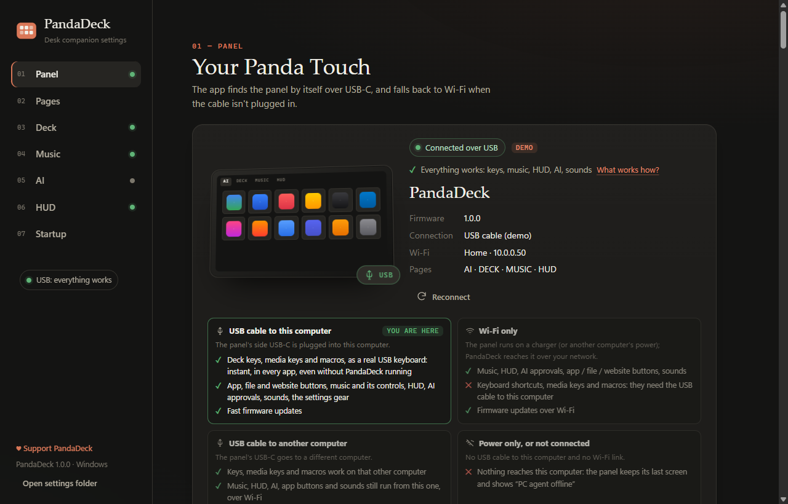

# 3. Make it yours

Open the settings page: tap the **⚙ gear** on the panel, use the tray icon's
**Open settings**, or go to <http://127.0.0.1:47321>.

Everything you change shows up on the panel within a second. Here's a five-minute tour.

## 1. Pages

Choose which tabs the panel shows and in which order: **AI**, **DECK**, **MUSIC**, **HUD**.
Drag to reorder, switch off what you don't need.

## 2. Deck → your apps

* **Fill with my most-used apps** puts your 18 favourite apps on the APPS page.
* Click a tile to **rename** it, give it **your own picture** or a colour.
* Drag to reorder, ✕ to remove.
* **Add a file… / folder… / website…** — a button can open anything, not just apps:
  a document, a project folder, a script, a game, a web page.

More in [the deck guide](04-deck.md), including **macros** (record any key combination).

## 3. Music

Works right away with what's playing on your computer. Pick the background — the
**blurred album cover** or the **artist's photo** — and optionally
[sign in with Spotify](05-music.md#sign-in-with-spotify).

## 4. HUD

Your computer's stats are automatic. Give it a nicer name than its host name, and
optionally [add your home server](06-hud.md#connect-a-homelab).

## 5. AI (optional)

Only if you use Claude Code or Codex: see [the AI page guide](07-ai.md).

## 6. Panel

Connection status, screen flip, brightness, Wi-Fi and firmware updates.

## 7. Startup

PandaDeck starts with your computer by default; switch it off here.

---

Your settings live on your computer only, in:

| System | Folder |
|---|---|
| Windows | `%APPDATA%\PandaDeck` |
| macOS | `~/Library/Application Support/PandaDeck` |
| Linux | `~/.config/pandadeck` |
